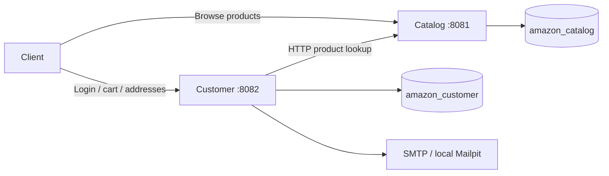

# Amazon-inspired backend

This is a small e-commerce API for learning Spring Boot and basic microservices. Follow the [root setup guide](../README.md) to start it.

## Services

| Service | Port | Own database | Responsibility |
| --- | --- | --- | --- |
| Catalog | 8081 | `amazon_catalog` | Browse, search and view products |
| Customer | 8082 | `amazon_customer` | Authentication, cart and delivery addresses |

The customer service calls `GET /api/products/{id}` on the catalog using Spring's `RestClient`. A cart stores a product ID; it never reads the catalog's database directly. Catalog failures return 503 to the caller. Catalog and customer accounts are independent of the help desk.



## Endpoints

All paths below are relative to the relevant service. Catalog endpoints are public. Customer endpoints require a bearer token except registration, login and password reset.

| Method | Path | Action |
| --- | --- | --- |
| GET | `:8081/api/products?q=mouse&category=Electronics&page=0&size=10` | Search name/description; optional category filter |
| GET | `:8081/api/products/{id}` | Product detail |
| POST | `:8082/api/auth/register` | Create customer |
| POST | `:8082/api/auth/login` | Return JWT |
| GET | `:8082/api/auth/me` | Current customer |
| POST | `:8082/api/auth/forgot-password` | Email one-time reset token |
| POST | `:8082/api/auth/reset-password` | Set a new password |
| GET | `:8082/api/cart` | Items, current prices, subtotals and total |
| POST | `:8082/api/cart/items` | Add product/quantity; adds to an existing quantity |
| PUT | `:8082/api/cart/items/{id}` | Replace item quantity |
| DELETE | `:8082/api/cart/items/{id}` | Remove cart item |
| GET | `:8082/api/addresses` | List own addresses |
| GET | `:8082/api/addresses/{id}` | View own address |
| POST | `:8082/api/addresses` | Add address |
| PUT | `:8082/api/addresses/{id}` | Replace address fields |
| DELETE | `:8082/api/addresses/{id}` | Delete address |

Use the **cart item ID** from the add response when updating/removing an item. It is different from the product ID. Quantities must be 1–99 and within current stock. Use DELETE to remove an item instead of setting quantity to zero. Prices use `BigDecimal`, with sample amounts in INR. Catalog prices are read again when viewing the cart; stock is not reserved.

Pages are zero-based; page sizes must be 1–100. List responses contain `content`, `totalElements`, `totalPages`, `number` and `size`.

## Suggested lesson

1. Start the catalog with the `demo` profile. Search for `Wireless Mouse` and view its details.
2. Register a customer and log in. Copy the token into [requests.http](requests.http).
3. Add two mice to the cart and inspect the total. Update the quantity, then delete the item.
4. Add, update, list and delete an address.
5. Register a second customer and confirm that the first customer's records cannot be accessed.
6. Request a password reset, open <http://localhost:8025>, and use the emailed token to change the password.

The catalog has read APIs only; sample products are inserted by `SampleProducts` when the demo profile starts on an empty table. Adding an administrator-only product editor is a suitable follow-up assignment.

Run only this project's tests from the repository root:

```powershell
.\mvnw.cmd -pl amazon-clone/catalog-service,amazon-clone/customer-service verify
```
