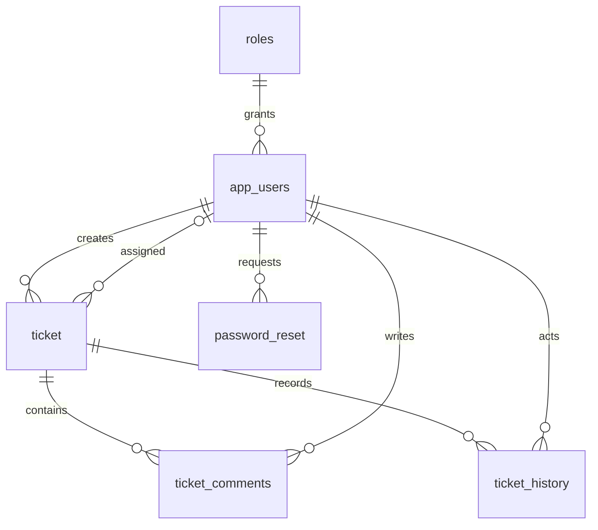

# Database design

JPA entities define the tables, columns and relationships. `spring.jpa.hibernate.ddl-auto=update` creates/updates them when each application starts. MySQL 8.4 is used by Docker Compose; isolated H2 databases are used only for tests. See [init.sql](init.sql) for Docker database creation and [local-setup.sql](local-setup.sql) for existing local MySQL installations.

## Amazon databases

| Database/table | Main columns | Constraints/relationships |
| --- | --- | --- |
| `amazon_catalog.product` | id, name, description, category, price, stock | Decimal price; required fields |
| `amazon_customer.app_users` | id, name, email, password, role | Unique email; password hash |
| `amazon_customer.password_reset` | id, token_hash, user_id, expires_at | User FK; unique token hash |
| `amazon_customer.cart_item` | id, user_id, product_id, quantity, version | User FK; unique (user, product) |
| `amazon_customer.address` | id, user_id, recipient, phone, line1, city, state, postal_code, country | User FK |

`product_id` is a remote product identifier, not a cross-database foreign key. The customer service checks it over HTTP. A user's cart is represented by their cart-item rows, keeping the design small. The e-commerce role is fixed to CUSTOMER.

## Help desk database

| Table | Main columns | Constraints/relationships |
| --- | --- | --- |
| `roles` | name | Primary key: CUSTOMER, AGENT or ADMIN |
| `app_users` | id, name, email, password, role_name | Unique email; role FK |
| `password_reset` | id, token_hash, user_id, expires_at | User FK; unique token hash |
| `ticket` | id, title, description, status, priority, category, customer_id, agent_id, created_at, updated_at, version | Customer/agent FKs; agent initially null |
| `ticket_comments` | id, ticket_id, author_id, message, created_at | Ticket/user FKs |
| `ticket_history` | id, ticket_id, actor_id, action, from_status, to_status, created_at | Ticket/user FKs |



`version` is an optimistic-lock field: conflicting edits return 409 instead of silently overwriting each other. Enums are stored as strings so database rows are readable. Business rules such as allowed status transitions and maximum cart quantity are checked by services.

To inspect the schema after startup:

```sql
USE helpdesk;
SHOW TABLES;
SHOW CREATE TABLE ticket;
SELECT id, title, status, priority, customer_id, agent_id FROM ticket;
SELECT * FROM ticket_history ORDER BY id;
```
