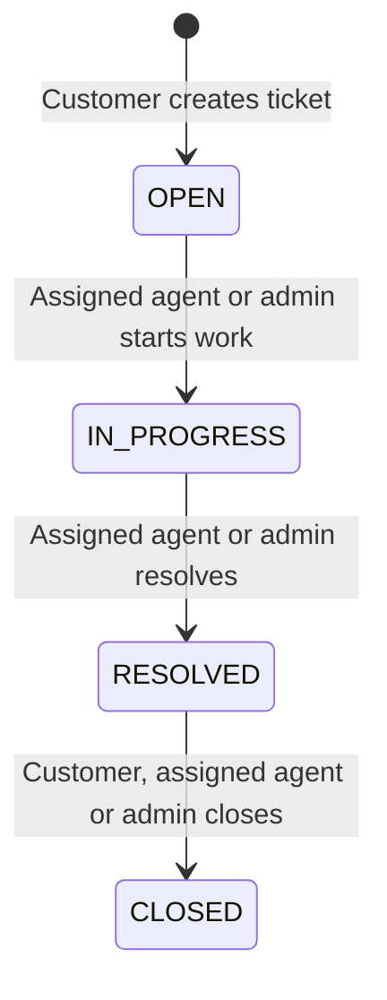

# Help desk ticket system

A student-friendly Spring Boot API for support tickets. It runs on port **8083** with a MySQL database named `helpdesk`. Follow the [root setup guide](../README.md) to start it. Ready-to-use requests are in [requests.http](requests.http).

## Roles and access

| Action | Customer | Agent | Admin |
| --- | --- | --- | --- |
| Register through public API | Creates customer only | — | — |
| Create ticket | Yes | No | No |
| View/search tickets, comments and history | Own tickets | Assigned tickets | All tickets |
| Edit title, description, priority, category | Own OPEN tickets | Assigned OPEN/IN_PROGRESS tickets | Any OPEN/IN_PROGRESS ticket |
| Assign or reassign an agent | No | No | Active tickets only |
| Move OPEN → IN_PROGRESS → RESOLVED | No | Assigned tickets | All tickets |
| Close a RESOLVED ticket | Own ticket | Assigned ticket | Any ticket |
| Add comment | Own non-closed ticket | Assigned non-closed ticket | Any non-closed ticket |
| List support agents | No | No | Yes |

Roles are stored in `roles` and referenced by `app_users`. Every protected request loads the current user's role from the database. The public registration endpoint cannot grant elevated roles.

Demo startup creates `admin@example.test` and `agent@example.test` using the configured demo passwords. To create additional agents for a classroom exercise, register the account first, then run this as the database administrator:

```sql
USE helpdesk;
UPDATE app_users SET role_name = 'AGENT' WHERE email = 'new-agent@example.test';
```

An admin creation/role-management API is intentionally left as a student extension. There are no public role-change endpoints.

## Workflow



An agent must be assigned before work starts. Skipping stages, reopening and editing resolved/closed tickets return 400. Assignment and status updates write a history entry in the same transaction. History records the actor, previous/new status, action and time; detail changes are also recorded. Comments have their own author and timestamp.

Priorities: `LOW`, `MEDIUM`, `HIGH`, `URGENT`. Categories: `GENERAL`, `ACCOUNT`, `BILLING`, `TECHNICAL`. These fixed enums keep the project simple; they are selected when creating/updating a ticket. There is no category/priority CRUD API.

## Endpoints

All paths are relative to `http://localhost:8083`.

| Method | Path | Action |
| --- | --- | --- |
| POST | `/api/auth/register` | Register customer |
| POST | `/api/auth/login` | Get JWT |
| GET | `/api/auth/me` | View current user |
| POST | `/api/auth/forgot-password` | Email reset token |
| POST | `/api/auth/reset-password` | Change password with token |
| POST | `/api/tickets` | Create ticket |
| GET | `/api/tickets` | Search/filter/paginate visible tickets |
| GET | `/api/tickets/{id}` | View ticket |
| PUT | `/api/tickets/{id}` | Update title, description, priority and category |
| PATCH | `/api/tickets/{id}/assignment` | Admin assigns `agentId` |
| PATCH | `/api/tickets/{id}/status` | Change `status` |
| POST | `/api/tickets/{id}/comments` | Add `message` |
| GET | `/api/tickets/{id}/comments` | List comments |
| GET | `/api/tickets/{id}/history` | List history |
| GET | `/api/admin/agents` | List agent IDs for assignment |

Example filtered request:

```http
GET /api/tickets?q=login&status=OPEN&priority=HIGH&category=ACCOUNT&page=0&size=10&sortBy=createdAt&direction=desc
Authorization: Bearer <token>
```

Filters are optional. `q` searches title and description without case sensitivity. Page numbers start at zero; sizes are 1–100. Allowed sorting fields are `id`, `title`, `createdAt`, `updatedAt`; direction is `asc` or `desc`. Visibility is filtered in the database before pagination, so totals only count accessible tickets. The admin's filtered list is also the simple progress-tracking API.

Successful creates return 201. Invalid input/workflow returns 400, missing/invalid authentication 401, insufficient access 403, absent records 404, and simultaneous-edit conflicts 409. Validation errors include a `message` and an `errors` list. Spring Security handles authentication failures before the controller.

## Suggested lesson

1. Register a customer, log in, and create an OPEN ticket.
2. Log in as admin. List agents and assign the ticket to one.
3. Log in as that agent. Move it to IN_PROGRESS, add a comment, then mark it RESOLVED.
4. Log in as the customer and close it. Read the history.
5. Create another customer and confirm they cannot read the ticket or its comments/history.
6. Try invalid transitions, filters and page values to understand validation.

Run the tests from the repository root:

```powershell
.\mvnw.cmd -pl help-desk verify
```
